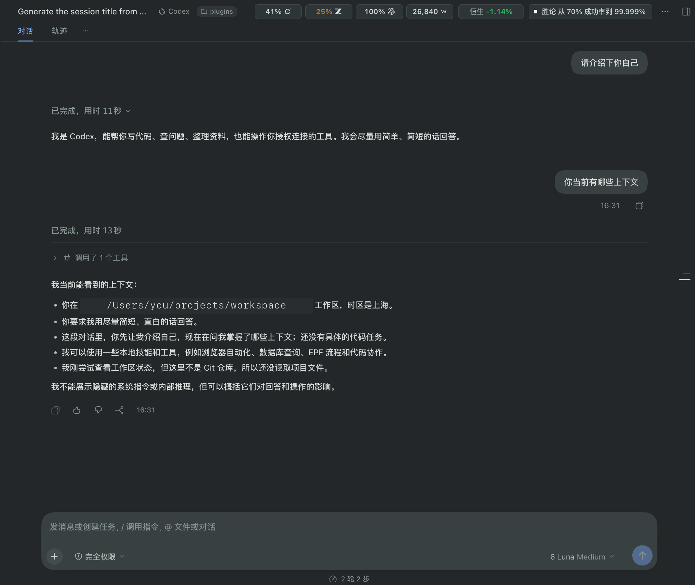

# dsh-market-indices

在 DSH 会话标题栏显示市场行情卡片，尺寸与 `dsh-quota` 额度卡片对齐。标题栏卡片轮播已开启轮播开关的品种；鼠标悬浮展示全部行情，可拖动排序、输入代码添加、点 × 移除。点击名称会打开东方财富行情页。A 股市场红涨绿跌。点击卡片可立即刷新；悬浮面板的「刷新」开关控制自动更新，开启时页面可见默认每 15 秒请求一次，服务端 8 秒内复用结果。




行情来自东方财富公开批量接口（Eastmoney `ulist.np`，`fltt=2` 返回真实价和涨跌幅）。默认关注：上证指数、创业板指、恒生指数、纳斯达克、标普500。也可添加其它 A 股、ETF、港股或美股代码。美股与港股的交易时段和 A 股不同，盘中时间可能不同步。恒生与标普、纳指在东财无数据时回退腾讯（腾讯需用带点的代码，纳指取的是综合指数 `us.IXIC`，不是纳斯达克 100）。接口可能限流或变更；单只品种失败显示不可用，其它品种仍正常显示；有缓存时返回失败则标注过期数据。设置保存在本机浏览器。

## 安装

```sh
dsh plugin --profile web add github:lidaiyue/dsh-market-indices
```

也可以指向本地源码目录：`dsh plugin --profile web add /absolute/path/to/dsh-market-indices`。装完重启 DSH Web。

接口（仅允许 loopback Host/Origin）：

- `GET /plugins/dsh-market-indices/status`：响应包含 `quotes` 与 `updatedAt`。`?secids=1.000001,0.399006` 指定关注列表，`?refresh=1` 强制回源。
- `GET /plugins/dsh-market-indices/resolve?q=513050`：按代码或名称检索可添加的品种。
